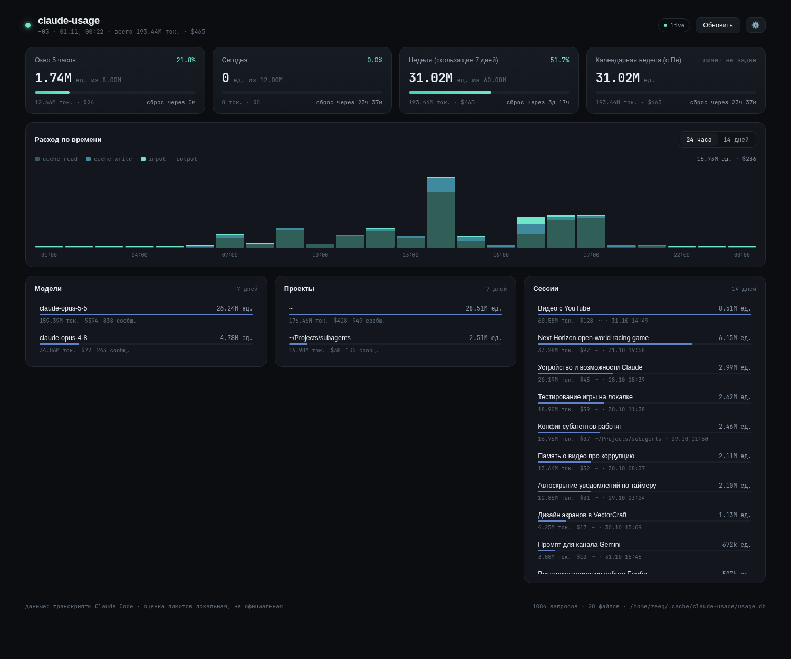

# claude-usage

Локальный сервер статистики Claude Code: читает JSONL-транскрипты из `~/.claude/projects`,
считает токены по каждому запросу и показывает, сколько съедено за 5-часовое окно,
за сегодня, за 7 дней и за календарную неделю.

Без зависимостей — только стандартная библиотека Python 3.9+ и SQLite.



## Запуск

```bash
python3 server.py                 # http://127.0.0.1:8787, браузер откроется сам
python3 server.py --no-open       # без браузера
python3 server.py --port 9000
python3 server.py --once          # сводка в терминал и выход
```

Первый запуск индексирует все транскрипты (`~118 МБ` — около 0.5 с), дальше читаются
только новые строки: позиция в каждом файле хранится в SQLite.

## Что считается

* Берутся только `assistant`-записи с `message.usage`.
* Один ответ API Claude Code пишет в JSONL несколько раз (по блокам контента,
  `apiBlockIndex` 0..N) с одинаковым `usage` — поэтому события дедуплицируются
  по `message.id`, иначе счёт завышается в 2–3 раза.
* Токены: `input`, `output`, `cache_creation_input_tokens` (cache write),
  `cache_read_input_tokens` (cache read). Побочные агенты (`isSidechain`) входят в общий счёт.
* Стоимость — оценка по таблице цен в настройках.

## Лимиты

Официальные лимиты Claude сервер не отдаёт, поэтому это **локальная оценка**.
Расход переводится в условные «единицы» по весам:

| токены | вес по умолчанию |
|---|---|
| input | 1.0 |
| output | 5.0 |
| cache write | 1.25 |
| cache read | 0.1 |

Лимиты (в единицах) задаются под свой план — в интерфейсе через шестерёнку
или в `config.json`. Окна:

* `session` — скользящие 5 часов, сброс = момент, когда самое старое событие выйдет из окна;
* `day` — календарный день;
* `week` — скользящие 7 дней;
* `calendar_week` — неделя с понедельника.

Можно добавить своё окно, например «Opus за 7 дней»:

```json
"week_opus": {
  "label": "Opus за 7 дней",
  "mode": "rolling",
  "days": 7,
  "model": "opus",
  "limit": 30000000
}
```

`limit: 0` — лимит не задан, полоска не рисуется, но расход показывается.
`model` — подстрока в названии модели (`opus`, `sonnet`, `haiku`).

## API

| метод | путь | что отдаёт |
|---|---|---|
| GET | `/api/summary` | окна, серии по часам/дням, разбивка по моделям, проектам, сессиям |
| GET | `/api/breakdown?by=model\|project\|session_id&range=today\|24h\|7d\|30d\|all` | агрегаты за период |
| GET | `/api/session?id=<session-id>` | все запросы сессии |
| GET/POST | `/api/config` | чтение/сохранение лимитов, весов, цен |
| POST | `/api/refresh` | дочитать новые строки JSONL сейчас |
| GET | `/api/status` | сколько событий и файлов в индексе |

## Файлы

```
server.py          сервер + индексатор (stdlib)
config.json        создаётся при первом запуске; лимиты, веса, цены, часовой пояс
static/            дашборд (HTML/CSS/JS, без сборки)
~/.cache/claude-usage/usage.db   индекс SQLite
```

Переменные окружения: `CLAUDE_CONFIG_DIR` (каталог Claude, по умолчанию `~/.claude`),
`CLAUDE_USAGE_CONFIG` (путь к config.json), `XDG_CACHE_HOME`.

## Автозапуск (systemd, user)

```bash
mkdir -p ~/.config/systemd/user
cp claude-usage.service ~/.config/systemd/user/
systemctl --user daemon-reload
systemctl --user enable --now claude-usage
systemctl --user status claude-usage
```

Лог читается так: `journalctl --user -u claude-usage -f`.

## Удалить индекс

```bash
rm ~/.cache/claude-usage/usage.db   # пересоберётся при следующем запуске
```
